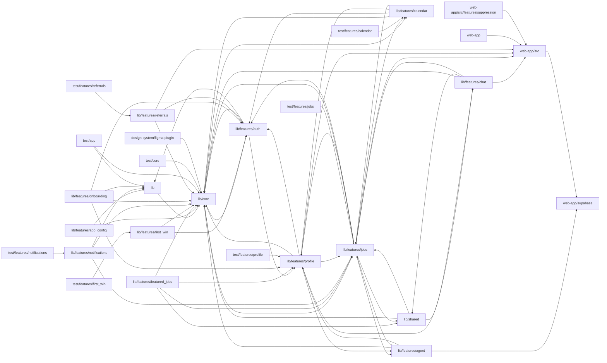

# Architecture

DJTILBUD is a two-sided marketplace connecting customers with DJs and instrumentalists (saxophonists). The repository contains three runtime stacks: (1) a Flutter/Riverpod musician mobile app under lib/ organized as a core layer (design system, Supabase client, notifications, analytics, pricing utilities, error mapping) plus clean-architecture feature slices (data/datasources -> data/repositories -> domain -> presentation/providers -> screens/widgets) for auth, jobs, calendar, chat, profile, agent (AI), referrals, notifications, app_config, first_win, featured_jobs and onboarding; (2) a Next.js web-app under web-app/src providing customer, DJ, musician, partner and ext-DJ portals, API route handlers, repositories over Supabase, cron automation (job lifecycle, waves, billing snapshots, reminders), matching/ranking algorithms, and shared domain helpers that the mobile app mirrors (budget adjustment, sax pricing, equipment parsing, phone formatting); (3) Supabase Edge Functions under web-app/supabase for FCM push notifications, encrypted payment info, and the Anthropic-backed agent-assist used by the mobile 'Skriv med AI' pitch generator, job summaries and Profile Coach. Supporting assets include a Figma plugin that renders the design tokens, Trustpilot import scripts, Dart test suites enforcing mobile/web pricing parity, and Vitest suppression tests. AI touchpoints are concentrated in lib/features/agent, the agent-assist edge function, the AI usage analytics/error mapping in lib/core, AgentAiButton integration in job offer forms and profile screens, and admin support AI-triage outcome tracking in web-app/src.

## Modules

| module | summary | AI |
| --- | --- | --- |
| `design-system/figma-plugin` | Figma plugin script rendering design tokens and component mockups mirroring the Flutter design system. | — |
| `lib` | Flutter app entrypoint and root App widget bootstrapping env, Supabase, Firebase, notifications, routing and onboarding gating. | — |
| `lib/core` | Shared mobile infrastructure: design system widgets/tokens, theme, Supabase client, notifications, analytics, exceptions, Danish error messages and pricing/formatting utilities. | [AI] |
| `lib/features/agent` | Client-side AI integration streaming SSE from the agent-assist edge function for sales pitches, job summaries, profile bios and Profile Coach. | — |
| `lib/features/app_config` | Remote version gating with force/soft update screens driven by Supabase AppConfig and local cache. | [AI] |
| `lib/features/auth` | Login, signup, password reset, impersonation tokens and DJ/instrumentalist role detection with profile setup. | — |
| `lib/features/calendar` | Calendar views of won/sent/new jobs, unavailable date management and iCal export. | — |
| `lib/features/chat` | Real-time messaging, admin support threads, reactions, typing indicators, attachments and @job link resolution. | — |
| `lib/features/featured_jobs` | Screens for assigned external 'Udvalgte jobs' with customer contact, billing readiness and extra hours. | — |
| `lib/features/first_win` | First-win celebratory walkthrough dialog gated via Supabase RPC per role/variant. | — |
| `lib/features/jobs` | Job discovery, DJ quotes, musician service offers, collision/availability rules, detail screens and reusable job widgets. | [AI] |
| `lib/features/notifications` | In-app notification centre with real-time feed, stale-bid expiry, read state and badge sync. | — |
| `lib/features/onboarding` | Multi-step onboarding wizard validating profile, media, reviews and filters. | — |
| `lib/features/profile` | Profile editing, media, billing/self-billing, filters, reviews, stats, templates and AI Profile Coach entry points. | — |
| `lib/features/referrals` | Lead referral submission, status tracking and terms acceptance against the web-app REST API. | — |
| `lib/shared` | Cross-feature widgets: chat FAB, avatars, conversation cards, job badges, venue photos and partner wishes. | — |
| `test` | Placeholder widget test. | — |
| `test/app` | Deep-link role resolution, router readiness and keyboard dismiss bar regression tests. | — |
| `test/core` | Unit/widget tests for core utils, budget parity, sax season pricing, phone/name formatting and DSInput keyboard behavior. | — |
| `test/features/calendar` | Tests for CalendarEventModel budget/payout display mapping. | — |
| `test/features/first_win` | Tests for first-win variant decision logic and RPC mapping. | — |
| `test/features/jobs` | Tests for quote models, bid status, availability, validation, billing gate and duration logic. | — |
| `test/features/notifications` | Tests for stale bid invitation detection. | — |
| `test/features/profile` | Tests for billing lock parsing, self-billing rules, stats computation, file sorting and stats screen. | — |
| `test/features/referrals` | Tests for referral models, phone formatting, labels and ReferralsScreen states. | — |
| `web` | Flutter web entry HTML. | — |
| `web-app` | Next.js root config: Sentry, PWA, env validation, Vitest and ESLint setup. | — |
| `web-app/documentation` | Static HTML prototype of the Kokkedal Slot partner portal. | [AI] |
| `web-app/scripts` | CLI pipeline importing Trustpilot reviews via Apify into Supabase. | — |
| `web-app/src` | Next.js portals, API routes, repositories, cron automation, DJ matching/wave cascade, domain helpers and TanStack Query hooks. | [AI] |
| `web-app/src/features/suppression` | Vitest suite verifying suppressed DJs are hidden from jobs, quoting and availability. | — |
| `web-app/supabase` | Edge Functions for FCM push notifications, encrypted payment info and the Anthropic agent-assist LLM endpoint. | [AI] |

## Module dependencies

_`[AI]` marks modules with AI/LLM touchpoints (prompt files, model API calls, agent logic)._
