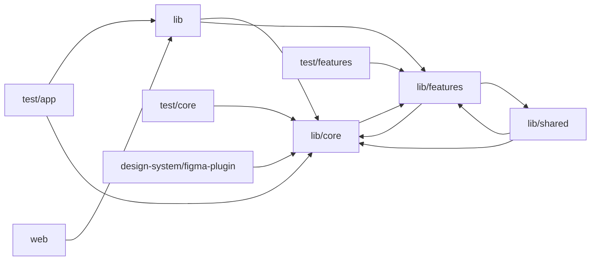

# Architecture

DJTILBUD candidate app: a Flutter (Riverpod + GoRouter + Supabase + Firebase) mobile app for DJs and instrumentalists in a two-sided event-music marketplace. lib/main.dart bootstraps env config, role cache, Supabase, Firebase/FCM and analytics; lib/app.dart wires a GoRouter route table gated by auth/onboarding notifiers. lib/core holds cross-cutting infrastructure: the DS design-system widget library and tokens (mirroring the web marketplace), theming, navigation shell with role-based tabs and badges, notifications, Supabase client/provider, typed AppException hierarchy with Danish user-facing error translation, analytics, and Dart ports of web-app pricing/budget/formatting helpers. lib/features is organised per feature in clean-architecture layers (data/datasources, models, repositories; domain/entities, rules, repository contracts; presentation/providers, screens, widgets) covering auth, jobs/quoting, calendar, chat and admin support, featured/ext jobs, first-win walkthrough, notifications, onboarding, profile/billing, referrals, app-config update gating, and an AI agent that streams sales-pitch, job-summary and profile-bio drafts from a Supabase 'agent-assist' edge function with daily/monthly usage limits. Business-rule writes are routed through web-app REST APIs; reads mostly go directly to Supabase tables with Realtime sync. lib/shared contains reusable job/chat widgets. Tests pin business-rule parity with the web app and routing/keyboard regressions. A Figma plugin script generates design-system mockups mirroring the Flutter DS, and web/ is a standard Flutter web shell.

## Modules

| module | summary | AI |
| --- | --- | --- |
| `design-system/figma-plugin` | Figma plugin script that renders the app's design tokens and components into Figma as a visual reference. | — |
| `lib` | App bootstrap (main.dart) and root App widget with GoRouter route table and auth/onboarding navigation gating. | — |
| `lib/core` | Shared infrastructure: DS design system, theme, navigation shell, notifications, Supabase client, errors (incl. AI agent error scrubbing), analytics, and web-mirrored pricing/formatting utils. | [AI] |
| `lib/features` | Layered feature modules (agent AI, auth, jobs/quoting, calendar, chat, profile, notifications, onboarding, referrals, first-win, app-config) for the musician app. | [AI] |
| `lib/shared` | Reusable job/chat UI widgets such as chat FAB, conversation card, job id badge, locked banners and partner venue cards. | — |
| `test` | Placeholder trivial widget test. | — |
| `test/app` | Regression tests for deep-link role resolution, router readiness, and keyboard-dismiss-bar layout stability. | — |
| `test/core` | Unit tests pinning core utils (budget, sax pricing, phone, names) and DSInput keyboard behavior against web-app parity. | — |
| `test/features` | Feature-level tests pinning jobs, quoting, payouts, billing, stats, referrals and notification rules to the web app. | — |
| `web` | Flutter web HTML entry point and hosting shell. | — |

## Module dependencies

_`[AI]` marks modules with AI/LLM touchpoints (prompt files, model API calls, agent logic)._
