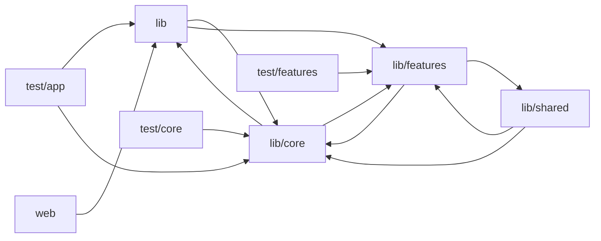

# Architecture

dj_tilbud_app is the Flutter candidate (musician/DJ) app for the DJTILBUD two-sided marketplace. lib/main.dart bootstraps env config, role cache, Supabase, Firebase/FCM, and analytics, then lib/app.dart builds a GoRouter whose redirects are driven by auth and onboarding ChangeNotifiers. lib/core holds cross-cutting infrastructure: the DS design-system widget library and tokens (which mirror the web marketplace), theme, navigation shell with role-based tabs and badges, Supabase client and providers, push notifications, a typed exception hierarchy with Danish user-facing error messages, analytics, and Dart ports of web-app pricing and budget rules. lib/features is organised by feature in clean-architecture layers (data/datasources+models+repositories, domain/entities+rules+repository contracts, presentation/providers+screens+widgets) and wired with Riverpod. Features include auth, jobs/quoting, calendar, chat, notifications, profile/billing, referrals, first_win, onboarding, app_config, and an AI agent. The agent feature streams sales-pitch, job-summary, and profile-bio drafts from a Supabase 'agent-assist' edge function, with daily and monthly usage limits. Business-rule-gated writes go through web-app REST endpoints; reads go directly to Supabase tables, with Realtime used where it is available. lib/shared contains reusable job and chat widgets. The test suites pin business rules so they stay in parity with the web app. A separate Figma plugin renders design-system mockups, and web/ is the Flutter web shell.

## Modules

| module | summary | AI |
| --- | --- | --- |
| `design-system/figma-plugin` | Figma plugin script that draws the design-system tokens and components to mirror the Flutter widgets. | — |
| `lib` | App bootstrap (Supabase, Firebase, env, role cache) plus the GoRouter route table, gated by auth and onboarding notifiers. | — |
| `lib/core` | Shared infrastructure: DS widget library and tokens, theme, navigation shell, Supabase, notifications, analytics, errors, and pricing/formatting utils. | [AI] |
| `lib/features` | Feature modules (jobs/quoting, calendar, chat, profile, referrals, notifications, onboarding, auth, app_config, first_win, AI agent) in data/domain/presentation layers with Riverpod. | [AI] |
| `lib/shared` | Reusable job and chat widgets such as the chat FAB, conversation card, job ID badge, locked banner, and venue photo/event wishes cards. | — |
| `test` | Placeholder trivial widget test. | — |
| `test/app` | Regression tests for deep-link role resolution, router readiness, and keyboard-bar layout stability. | — |
| `test/core` | Unit and parity tests for core pricing, budget, phone, and notification utilities and the DSInput keyboard behavior. | — |
| `test/features` | Tests pinning feature business rules (jobs, quoting, billing, stats, referrals, notifications) to stay in parity with the web app. | — |
| `web` | Flutter web HTML shell and manifest. | — |

## Module dependencies

_`[AI]` marks modules with AI/LLM touchpoints (prompt files, model API calls, agent logic)._
