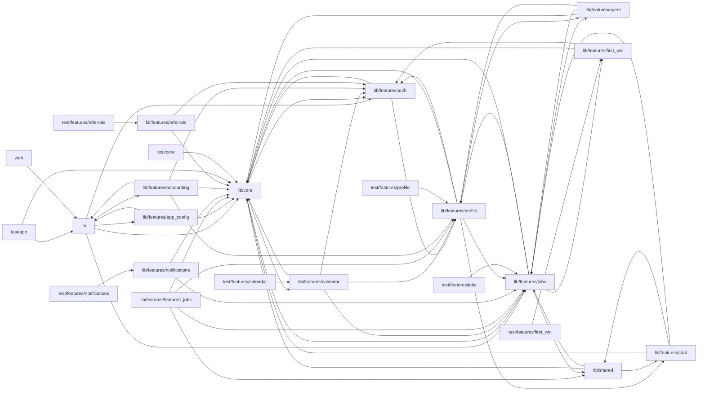

# Architecture

DJTILBUD is a Flutter mobile app (iOS/Android/web) for musicians (DJs and instrumentalists/saxophonists) on the DJTILBUD marketplace. The root `lib` module boots Firebase, Supabase, push notifications, analytics and env config, then mounts a GoRouter-driven app gated by auth, onboarding and forced-update checks. `lib/core` supplies cross-cutting infrastructure: a DS-prefixed design system with semantic tokens, a sealed AppException hierarchy with Danish error translation, Supabase client/provider, FCM handling, theme, routing constants, and pure domain utilities (budget/fee math, high-season pricing, equipment encoding, iCal). Features follow a clean-architecture layout (data/datasources → data/models → data/repositories → domain/entities+repositories → presentation/providers+screens+widgets) with Riverpod for state and Supabase Realtime for live sync. Feature modules cover auth, onboarding, jobs (the largest: job browsing, quotes/offers, ext jobs, content uploads, billing gates), calendar, chat (incl. admin support), notifications, profile (billing, media, stats, filters), referrals, first-win walkthroughs, featured external jobs and remote app-config version gating. The `agent` feature is the AI touchpoint: it streams responses from the `agent-assist` Supabase Edge Function over SSE for sales-pitch drafting/refinement, job summaries, profile bio writing and profile coaching, with quota tracking; jobs and profile screens embed its widgets, and core carries the AgentException/AgentLimitException types plus the usedAiDraft analytics flag. A Figma plugin script mirrors the design tokens for designers, and a test tree provides unit/widget parity tests for budget math, domain gates, models and key screens.

## Modules

| module | summary | AI |
| --- | --- | --- |
| `design-system/figma-plugin` | Figma generator script rendering DJTILBUD design tokens and component previews to mirror the Flutter design system. | — |
| `lib` | App entry point: initializes Firebase, Supabase, push, analytics, env/role caches and configures the root widget and router. | — |
| `lib/core` | Shared infrastructure: DS design system and tokens, sealed exceptions with Danish error copy, Supabase client, FCM/notifications, theme, routes and domain utilities. | [AI] |
| `lib/features/agent` | AI assistant feature streaming sales pitches, job summaries, profile bios and profile coaching from the agent-assist edge function via SSE. | — |
| `lib/features/app_config` | Remote app configuration and forced/optional update gating by platform version. | [AI] |
| `lib/features/auth` | Sign-in, sign-up, password reset, DJ vs instrumentalist role detection and initial profile setup. | — |
| `lib/features/calendar` | Calendar of won quotes, ext jobs and offers with unavailable-date management and iCal export/subscription. | — |
| `lib/features/chat` | Real-time messaging for musicians and admin support threads with reactions, images, typing indicators and job mentions. | — |
| `lib/features/featured_jobs` | Screens for assigned external (Udvalgte) jobs: upcoming/played lists, contact logging and billing readiness. | — |
| `lib/features/first_win` | First-won-job celebration and role-specific walkthrough dialogs tracked via Supabase RPC. | — |
| `lib/features/jobs` | Core marketplace: job browsing, DJ quotes and musician offers, collision checks, lifecycle actions, content uploads and billing gates. | [AI] |
| `lib/features/notifications` | In-app notification feed, unread badge sync via Realtime/push, and auto-clearing of stale bid invitations. | — |
| `lib/features/onboarding` | Multi-step onboarding wizard for profile info, required media, reviews and job filters. | — |
| `lib/features/profile` | Profile editing, billing/payment and self-billing gates, media, reviews, standard messages, job filters, stats and settings. | — |
| `lib/features/referrals` | Lead referral submission, terms acceptance and referral/payout status tracking against the web API. | — |
| `lib/shared` | Cross-feature UI widgets: job ID badges, locked banners, copy rows, chat FABs, venue photo viewers. | — |
| `test` | Placeholder widget test entrypoint. | — |
| `test/app` | Regression tests for routing stability, deep-link role resolution and keyboard dismiss bar insets. | — |
| `test/core` | Parity unit tests for budget/pricing utilities, notification ID parsing and DSInput keyboard behavior. | — |
| `test/features/calendar` | Unit tests for CalendarEventModel budget/payout mapping. | — |
| `test/features/first_win` | Unit tests for first-win variant selection and RPC values. | — |
| `test/features/jobs` | Unit tests for job models, validation, billing gates, availability and duration formatting. | — |
| `test/features/notifications` | Unit tests for stale bid invitation detection. | — |
| `test/features/profile` | Unit and widget tests for billing logic, stats aggregation, terms gating and StatsScreen. | — |
| `test/features/referrals` | Unit and widget tests for referral models, phone normalization, labels and the referrals screen. | — |
| `web` | HTML host shell bootstrapping the Flutter web build. | — |

## Module dependencies

_`[AI]` marks modules with AI/LLM touchpoints (prompt files, model API calls, agent logic)._
