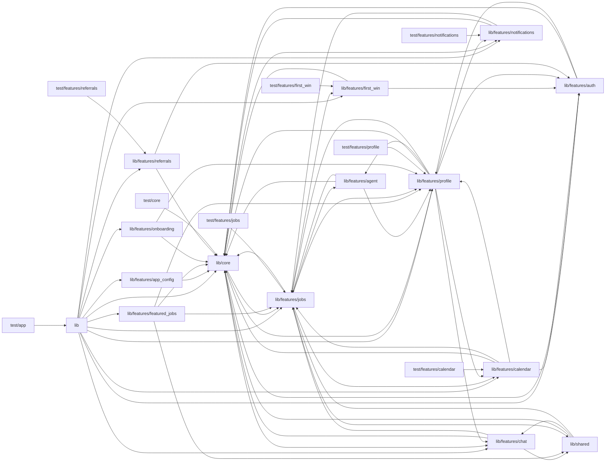

# Architecture

dj_tilbud_app is the musician-facing (DJ / instrumentalist) Flutter companion to a Danish event-music marketplace web app. lib/main.dart bootstraps env config, the role cache, Supabase, Firebase/FCM, analytics and notifications. lib/app.dart builds a GoRouter whose refresh is gated by auth and onboarding notifiers, and it wraps everything in an update gate (features/app_config). lib/core holds the shared infrastructure: design-system tokens and DS* widgets exported through one barrel, theming, the role-aware navigation shell with badges, the Supabase client and providers, the typed AppException hierarchy, and Danish error copy. It also holds analytics and Dart ports of web-app pricing and budget helpers. Feature modules under lib/features follow a clean-architecture split: data (remote datasources over Supabase tables or web-app /api endpoints, plus JSON models), domain (entities, pure rules, abstract repositories) and presentation (Riverpod providers, screens, widgets). Jobs is the hub: feed, quoting, won-job workflow and ext jobs. Calendar, featured_jobs, chat, notifications, profile and shared widgets all lean on it. The AI capability lives in features/agent. It streams SSE from a Supabase 'agent-assist' edge function to draft sales pitches, summarize jobs and coach or draft profile bios, with daily and monthly usage limits. It is invoked from the jobs quote forms and the profile screens. core/error scrubs raw Anthropic error bodies and core/analytics tracks whether an AI draft was used. Much business logic is deliberately mirrored from the web app's TypeScript and pinned by parity tests under test/. A Figma plugin script mirrors the design tokens for design documentation.

## Modules

| module | summary | AI |
| --- | --- | --- |
| `design-system/figma-plugin` | Figma plugin script that draws design tokens and components to mirror the Flutter DS widgets. | — |
| `lib` | App bootstrap (main.dart) and GoRouter/root App wiring with auth and onboarding gating. | — |
| `lib/core` | Shared infrastructure: design system, theme, nav shell, Supabase, notifications, errors (incl. AI error scrubbing), analytics, pricing/budget utils. | [AI] |
| `lib/features/agent` | AI agent: streams sales-pitch drafts, job summaries and profile coaching/bios from the agent-assist edge function, with usage limits. | — |
| `lib/features/app_config` | Version gating via the AppConfig row: forced or optional update screens. | [AI] |
| `lib/features/auth` | Sign-in/up, password reset, role detection and first-time profile setup. | — |
| `lib/features/calendar` | Calendar of new/sent/won jobs, unavailable dates and iCal export. | — |
| `lib/features/chat` | Realtime job conversations, admin support inbox, reactions and @job links. | — |
| `lib/features/featured_jobs` | List and detail screens for assigned ext jobs ('Udvalgte jobs'). | — |
| `lib/features/first_win` | One-time first-win walkthrough decision and dialog. | — |
| `lib/features/jobs` | Job feed, quoting/offers (with AI pitch button), won-job workflow, domain rules and realtime providers. | [AI] |
| `lib/features/notifications` | In-app notification center with realtime unread badge and stale bid-invitation clearing. | — |
| `lib/features/onboarding` | Multi-step onboarding wizard for completing the profile and DJ filters. | — |
| `lib/features/profile` | Profile, media, payment/self-billing, filters, stats, reviews; entry points to the AI bio and Profilcoach. | — |
| `lib/features/referrals` | 'Henvis en kunde' referral submission and tracking via web-app API. | — |
| `lib/shared` | Shared job/chat widgets (chat FAB, conversation card, badges, venue photos). | — |
| `test` | Placeholder trivial test. | — |
| `test/app` | Router, deep-link and keyboard-bar regression tests. | — |
| `test/core` | Parity and unit tests for core utils, notifications and DSInput. | — |
| `test/features/calendar` | Calendar budget display parity tests. | — |
| `test/features/first_win` | First-win variant decision tests. | — |
| `test/features/jobs` | Jobs domain and model rule tests. | — |
| `test/features/notifications` | Stale bid-invitation rule tests. | — |
| `test/features/profile` | Billing, stats, file ordering and terms gate tests. | — |
| `test/features/referrals` | Referral model, labels, phone and screen tests. | — |
| `web` | Flutter web HTML shell. | — |

## Module dependencies

_`[AI]` marks modules with AI/LLM touchpoints (prompt files, model API calls, agent logic)._
