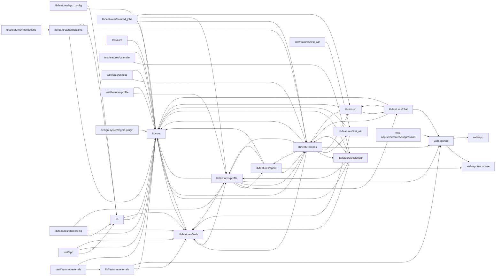

# Architecture

DJTILBUD is a Danish marketplace connecting customers with DJs and instrumentalists (primarily saxophonists). The repository holds three cooperating stacks: (1) a musician-facing Flutter mobile app under `lib/` organised in clean-architecture feature slices (data/datasources → data/repositories → domain/entities+repositories → presentation/providers+screens+widgets) with Riverpod state, go_router navigation, Supabase for data/auth/realtime and Firebase for analytics/push; (2) a Next.js + Chakra UI web application under `web-app/src` that serves customers, DJs, instrumentalists, partners and admins, exposes the REST API routes the mobile app calls (jobs, quotes, service offers, referrals, chat support, billing, deliveries), and runs background cron jobs for the job lifecycle, DJ supply-matching waves, billing snapshots and reminders; and (3) Supabase Edge Functions (Deno) under `web-app/supabase` that send FCM push notifications, store encrypted payout data, and host the `agent-assist` function that streams Anthropic Claude output for sales-pitch drafts, job summaries, bios and profile coaching. Cross-cutting business rules (platform fees, sax high-season pricing, budget adjustments for DJ tiers, 10-minute bid withdrawal windows, WKNDS equipment delivery deductions, self-billing completeness) are intentionally duplicated between `lib/core/utils` and `web-app/src/helpers`, with parity tests in `test/core`. A shared design system (`lib/core/design_system`, mirrored by a Figma generator plugin) provides `DS*` widgets and role-based tokens. AI touchpoints are concentrated in `lib/features/agent` (client), `web-app/supabase/functions/agent-assist` (LLM calls/prompts), and the admin support AI-decision bookkeeping in `web-app/src/app/api/chat/support/admin`.

## Modules

| module | summary | AI |
| --- | --- | --- |
| `design-system/figma-plugin` | Figma generator plugin that renders the DJTILBUD design tokens and component visuals to keep Figma in sync with Flutter widgets. | — |
| `lib` | Flutter app entry point: env/Firebase/Supabase bootstrap, background push handler, root auth/onboarding notifiers and GoRouter. | — |
| `lib/core` | Shared mobile infrastructure: env config, analytics, error hierarchy and Danish error copy, notifications, Supabase client, theme, design system, and business utility helpers. | [AI] |
| `lib/features/agent` | Mobile AI assistant client streaming SSE from the agent-assist edge function for pitch drafts, refinements, job summaries, bios and profile coaching. | — |
| `lib/features/app_config` | Remote AppConfig fetch/cache driving force-update and soft-update gating by semantic version. | [AI] |
| `lib/features/auth` | Supabase auth flows, role detection (DJ vs instrumentalist), password reset, impersonation and profile-setup routing. | — |
| `lib/features/calendar` | Musician calendar of won/sent/new events with unavailable-date management and iCal export/subscription. | — |
| `lib/features/chat` | Realtime job and support chat with reactions, typing indicators, image attachments, @job mentions and admin support inbox. | — |
| `lib/features/featured_jobs` | Screens for assigned external/partner jobs (upcoming vs played) with contact tracking and ready-for-billing actions. | — |
| `lib/features/first_win` | First-win celebration/walkthrough dialogs with variant resolution and mark-shown RPC. | — |
| `lib/features/jobs` | Core marketplace feature: job feed, DJ quotes, instrumentalist service offers, ext jobs, delivery logistics, payouts, bid windows and conflict rules. | [AI] |
| `lib/features/notifications` | In-app notification feed with realtime updates, OS badge sync and stale bid-invitation auto-clearing. | — |
| `lib/features/onboarding` | Multi-step onboarding wizard collecting profile, media, reviews and job filters per role. | — |
| `lib/features/profile` | Profile, media, reviews, payment/self-billing, job filters, standard messages, stats and AI bio/coach entry points. | — |
| `lib/features/referrals` | Customer lead referral submission and tracking via web-app REST endpoints with terms gating. | — |
| `lib/shared` | Cross-feature widgets: chat FAB/cards, avatars, job badges, venue photos, partner event wishes, delivery notices. | — |
| `test` | Placeholder Flutter widget test scaffold. | — |
| `test/app` | Regression tests for deep-link role resolution, router readiness and keyboard dismiss bar insets. | — |
| `test/core` | Parity and unit tests for core utils (budget, sax season, phone, equipment) plus design-system contrast and input tests. | — |
| `test/features/calendar` | CalendarEventModel parsing and budget-label consistency tests. | — |
| `test/features/first_win` | First-win variant decision and RPC value tests. | — |
| `test/features/jobs` | Unit/widget tests for quotes, bid withdrawal, availability, delivery logistics, validation and billing gates. | — |
| `test/features/notifications` | Stale bid-invitation staleness rule tests. | — |
| `test/features/profile` | Tests for bank guards, self-billing completeness, performer stats, venues, file sorting and profile widgets. | — |
| `test/features/referrals` | Referral model, phone normalisation, labels and screen tests. | — |
| `web` | HTML host shell for the Flutter web build. | — |
| `web-app` | Next.js project configuration: Sentry, ESLint, PWA, env validation and Vitest setup. | — |
| `web-app/documentation` | Static partner-portal HTML prototypes and design documentation. | [AI] |
| `web-app/scripts` | CLI scripts to scrape Trustpilot reviews, match to DJs/jobs and insert approved reviews into Supabase. | — |
| `web-app/src` | Next.js web app: customer/DJ/musician/partner UIs, REST API routes consumed by mobile, cron lifecycle jobs, DJ matching cascade and domain helpers. | [AI] |
| `web-app/src/features/suppression` | Regression tests for DJ suppression exclusion logic. | — |
| `web-app/supabase` | Deno Edge Functions: Claude-powered agent-assist, FCM push notification dispatch/logging, and encrypted payment-info storage. | [AI] |

## Module dependencies

_`[AI]` marks modules with AI/LLM touchpoints (prompt files, model API calls, agent logic)._
